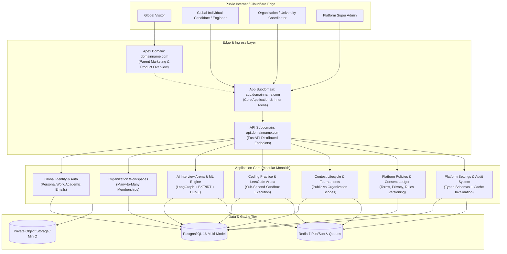

# TARGET ARCHITECTURE — GLOBAL PLATFORM DESIGN SPECIFICATION

**System Architecture:** Institution-Neutral Global Arena Platform  
**Target Topology:** Multi-Domain Parent & Workspace Architecture  

---

## 1. System Context Diagram

---

## 2. Core Entities & Relational Data Model

### 2.1 Identity & User Profiles (`member_profiles`)
- **Global User Entity:** Represents an individual engineer on the internet.
- **Attributes:** `id`, `handle`, `full_name`, `email` (RFC-compliant unique email), `avatar_url`, `bio`, `github_username`, `linkedin_url`, `rating` (global ELO), `peak_rating`, `locale`, `timezone`, `platform_role` (`USER`, `CORE_MEMBER`, `PLATFORM_ADMIN`).
- **Legacy Compatibility:** Preserves existing columns (`prn`, `department`, `batch`) as optional profile fields without breaking existing data.

### 2.2 Organizations (`organizations`)
- **Concept:** Optional institution, university, enterprise, bootcamp, or community workspace.
- **Attributes:**
  - `id`: UUID primary key
  - `slug`: Unique human-readable URL identifier (e.g. `medicaps-university`, `acm-global`)
  - `name`: Display name
  - `description`: Workspace mission statement and overview
  - `organization_type`: Enum (`UNIVERSITY`, `COMPANY`, `BOOTCAMP`, `COMMUNITY`, `OTHER`)
  - `logo_url`: CDN link to workspace emblem
  - `website`: Official portal link
  - `is_verified`: Boolean badge indicating institutional verification
  - `created_at`, `updated_at`

### 2.3 Organization Domains (`organization_domains`)
- **Purpose:** Used strictly for optional workspace discovery and auto-affiliation.
- **Rule:** Never used as a hard gate for platform registration.
- **Attributes:** `id`, `organization_id` (FK), `domain` (e.g. `medicaps.ac.in`, `mit.edu`), `is_verified`, `created_at`.

### 2.4 Organization Memberships (`organization_memberships`)
- **Cardinally:** Many-to-many relationship. A user may belong to zero, one, or multiple organizations.
- **Attributes:**
  - `id`: UUID primary key
  - `organization_id`: References `organizations.id`
  - `member_id`: References `member_profiles.id`
  - `role`: Enum (`MEMBER`, `COORDINATOR`, `ADMIN`)
  - `status`: Enum (`ACTIVE`, `INVITED`, `SUSPENDED`)
  - `joined_at`: Timestamp
  - `invited_by`: References `member_profiles.id` (nullable)

### 2.5 Invitations (`organization_invitations`)
- **Purpose:** Secure cryptographic workspace invites.
- **Attributes:** `id`, `organization_id`, `email`, `role`, `token_hash` (SHA-256), `expires_at`, `accepted_at`, `created_by`, `created_at`.

### 2.6 Platform Policies & Consents (`platform_policies`, `user_consents`)
- **Policies:** Exact versioned legal contracts (`TERMS_OF_SERVICE`, `PRIVACY_POLICY`, `CONTEST_RULES`, `CODE_OF_CONDUCT`, `ACCEPTABLE_USE`).
- **User Consents:** Immutable audit records storing `member_id`, `policy_id`, `policy_type`, `version`, `accepted_at`, `ip_address`, `user_agent`, and `source` (`SIGNUP`, `CONTEST_REGISTRATION`, `MODAL_PROMPT`).

### 2.7 Platform Settings (`platform_settings`, `platform_settings_audit`)
- **Typed Global Registry:** Key-value store for platform name, allowed domains, feature flags, signup policies, upload limits, and contest defaults.
- **Audit Ledger:** Captures `setting_key`, `old_value_json`, `new_value_json`, `changed_by`, `client_ip`, and timestamp.

---

## 3. Server-Side Resource Visibility Matrix

Every resource (Contest, Assessment, Problem, Interview Blueprint, Scoreboard) carries an explicit `visibility` level:

| Visibility Level | Description | Discovery | Authorization Rule |
|---|---|---|---|
| `public` | Globally accessible to all platform users | Public catalog, search, and RSS | Any authenticated (or anonymous public where supported) user |
| `unlisted` | Accessible only via direct URL or share link | Hidden from public catalogs | Anyone with valid link/token |
| `organization_private` | Strictly restricted to members of a specific organization | Visible only within the workspace | Caller must possess an active `organization_membership` in the referenced organization |
| `platform_admin_only` | Drafts, internal audits, and staging tests | Hidden from all normal users | Caller must have `platform_role IN ('CORE_MEMBER', 'PLATFORM_ADMIN')` |

---

## 4. Host Routing Strategy

- **Parent Marketing Website (`domainname.com`):** Serves public landing page, interactive problem demo, AI interview feature highlights, legal documentation, and "Launch App" CTA.
- **Product Application (`app.domainname.com`):** Serves the full authenticated web application, coding IDE, Monaco editors, voice chat arena, user profile, and workspace management.
- **API Backend (`api.domainname.com` or `/api` reverse proxy):** FastAPI asynchronous backend providing REST, SSE, and WebSocket endpoints.
