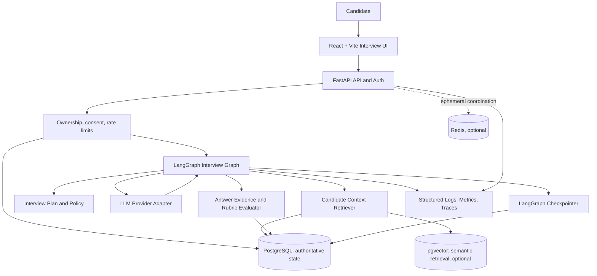
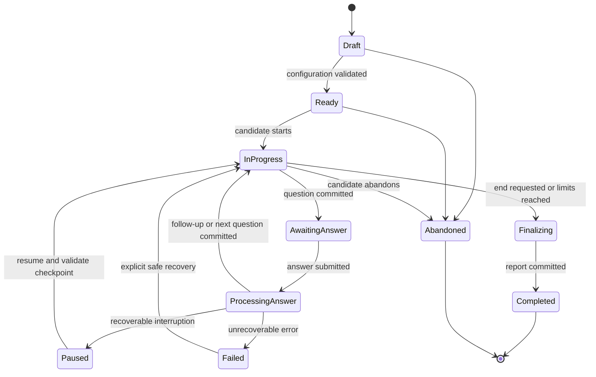
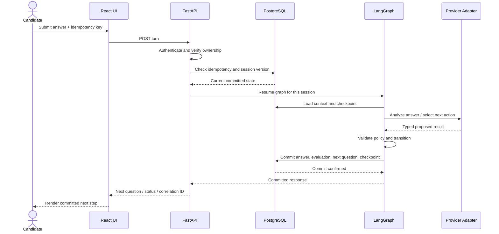
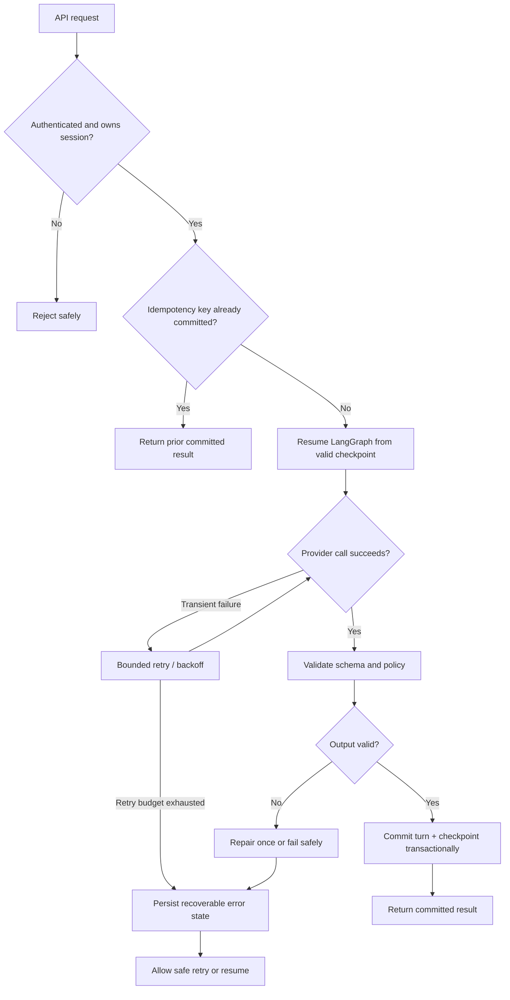

# CCC AI Interview Practice — End-to-End Product & Engineering Requirements
**Version:** 2.0  
**Status:** Engineering baseline / implementation-ready backlog  
**Product:** Chaos Computer Club (CCC) — AI Interview Practice  
**Primary orchestration framework:** **LangGraph**  
**Backend:** FastAPI  
**Primary data store:** PostgreSQL  
**Semantic retrieval:** pgvector (recommended if extension is available)  
**Coordination/cache:** Redis where justified  
**Frontend:** Existing React + Vite application, JSX (not TSX), using the repository's established state-management and design conventions.

> **Repository-first rule:** This is the target requirements baseline, not proof that every listed technology already exists in the repository. Before changing code, inspect the actual repository, package versions, deployment model, auth/session conventions, database migrations, tests, and UI design system. Preserve compatible existing patterns and document deviations before implementation.

---

## 1. Product goal

Build an AI interviewer that conducts realistic, adaptive, role-relevant interviews and gives useful evidence-based feedback. It should feel attentive and responsive—not like a static quiz or a generic chatbot.

The system must:
- Use candidate-provided context (resume, projects, target role, experience, goals) transparently.
- Ask one primary question at a time and follow up based on the actual answer.
- Adjust depth and difficulty using observed evidence, not unsupported assumptions.
- Track interview state reliably across turns, refreshes, reconnects, and recoverable failures.
- Evaluate answers against explicit rubrics and cite answer evidence in feedback.
- Protect candidate data, enforce ownership, and avoid inventing candidate history.
- Support incremental delivery, with text-based interviews first; voice and coding integrations are later phases.

## 2. Scope and non-goals

### In scope
1. Interview dashboard and session history.
2. Interview setup: role, seniority, focus areas, duration, mode, difficulty, and candidate context.
3. Candidate profile and consent-aware document ingestion.
4. Adaptive interviewer for technical, behavioral, project deep-dive, system-design, and later coding tracks.
5. LangGraph-based stateful orchestration, conditional routing, checkpointing, and recovery.
6. Answer analysis, evidence capture, competency scoring, and personalized feedback.
7. Persistence, session ownership, observability, safety, rate limits, and tests.
8. Feature flags and phased rollout.

### Not in initial MVP
- Training a custom neural network.
- A multi-agent swarm without a measured need.
- A dedicated graph database as a prerequisite.
- Automated hiring decisions or claims that the score predicts job performance.
- Emotion, personality, accent, facial-expression, or protected-trait inference.
- Production deployment, destructive migrations, or paid-provider changes without authorization.
- Voice and code execution before the text interview lifecycle is reliable.

## 3. Product principles

- **Human-like means context-aware and responsive, not deceptive.** The candidate must know this is an AI interviewer.
- **Evidence over vibes.** Evaluate the content and reasoning of answers, not accent, charisma, typing speed, or verbosity alone.
- **One question at a time.** Avoid compound questions unless the interview format explicitly requires them.
- **No fabricated memory.** Retrieved candidate facts must have provenance; uncertain information must be confirmed.
- **Adaptive, but bounded.** Difficulty changes must follow explicit policy and remain aligned with the selected interview plan.
- **Reliable state.** The database is authoritative; model output is not allowed to silently mutate session state.
- **Provider-neutral.** Keep LLM calls behind an adapter so model providers can be changed without rewriting the domain logic.
- **Accessible and recoverable.** Support keyboard use, clear loading/error states, resume after refresh, and graceful handling of timeouts.

## 4. Recommended architecture

### 4.1 Technology decisions
| Concern | Decision | Notes |
|---|---|---|
| Workflow orchestration | **LangGraph** | Explicit graph state, conditional edges, checkpoint/recovery, bounded loops. |
| HTTP/API layer | FastAPI | Follow existing auth, dependency injection, and API conventions. |
| Durable state | PostgreSQL | Source of truth for users, interview sessions, turns, evaluations, and memory facts. |
| Semantic retrieval | pgvector, if suitable | Optional retrieval layer; use normal SQL for structured facts. |
| Short-lived coordination | Redis, where useful | Locks, rate limits, cache, ephemeral coordination; not the sole source of truth. |
| LLM calls | Provider adapter | Typed inputs/outputs, timeouts, retries, token budgets, redaction, usage tracking. |
| Frontend | Existing React + Vite / JSX | Reuse established routing, components, theme, and state management. |
| Observability | Structured logs + metrics + traces | Consider LangSmith or equivalent only after privacy and cost review. |

### 4.2 Architecture Mermaid diagram

### 4.3 Runtime boundaries
- The API authenticates the user, checks session ownership, validates requests, and applies rate limits.
- LangGraph orchestrates model-assisted steps; it does not replace domain services, database transactions, authorization, or validation.
- The application layer owns allowed state transitions and persistence.
- The LLM proposes question text, extracted evidence, and evaluations using schemas. Validate these outputs before committing them.
- PostgreSQL remains authoritative. Redis and vector retrieval are accelerators, not the only copies of essential state.
- Do not store raw secrets, provider API keys, or unnecessary sensitive document content in prompts or logs.

## 5. Candidate personalization and memory

### 5.1 Candidate context inputs
- Candidate-entered target role, seniority, interview goals, and focus areas.
- Resume and project descriptions supplied by the candidate.
- Candidate-approved profile details and prior interview summaries.
- Past demonstrated competencies and unresolved learning gaps.
- Explicit preferences such as interview duration or preferred feedback detail.

### 5.2 Memory types
1. **Profile facts:** structured and user-editable (e.g., target role).
2. **Evidence facts:** claims tied to a specific answer, project description, or uploaded document.
3. **Learning signals:** observed strengths/gaps with confidence and recency.
4. **Session memory:** current interview plan, question history, current competency, and turn count.
5. **Semantic retrieval:** relevant prior facts retrieved for a question; optional pgvector index.

Each stored fact should include: `user_id`, `fact_type`, `value`, `source_type`, `source_id`, `created_at`, `updated_at`, `confidence`, and optional `expires_at`/`superseded_by`.

### 5.3 Memory policies
- Distinguish user-confirmed facts from model-inferred signals.
- Never convert an inference into a confirmed biographical fact without confirmation.
- Let users view, correct, and delete their profile/memory according to the product's retention policy.
- Use the minimum context needed for the current turn.
- Do not retrieve or expose another user's memory.
- Do not use protected traits or emotion/personality inference to score answers.
- Apply retention limits to raw documents and transcripts; document deletion propagation across embeddings and derived records.

### 5.4 Personalization behavior examples
- If the candidate claims to have built a queue, ask about delivery guarantees, retries, idempotency, and failure recovery.
- If the answer reveals a gap, ask a narrower diagnostic question before jumping to a harder topic.
- If the candidate demonstrates mastery, deepen the probe or move to the next planned competency.
- If candidate context is ambiguous or conflicts, ask for clarification rather than inventing an explanation.

## 6. LangGraph interview workflow

### 6.1 Required graph nodes
1. `load_session_and_profile`
2. `retrieve_relevant_context`
3. `validate_or_initialize_plan`
4. `select_next_question`
5. `present_question`
6. `await_candidate_answer` (API-driven boundary; do not hold a server worker open while waiting)
7. `analyze_answer`
8. `validate_evidence_and_score`
9. `choose_follow_up_or_next_topic`
10. `persist_turn_and_checkpoint`
11. `finalize_report`
12. `recover_or_fail_gracefully`

### 6.2 Graph policy
- Bound the number of follow-up loops per competency and the maximum total turns.
- Use conditional edges for `clarify`, `probe_deeper`, `move_on`, `candidate_skip`, `end_interview`, and `recover`.
- Keep API requests short-lived: persist a turn, return the response, and resume the graph on the next candidate action.
- Make turn creation idempotent using a client-generated request key or equivalent.
- Store checkpoint identifiers and application session IDs separately; validate that the checkpoint belongs to the authorized session.
- Treat model output as untrusted until schema and policy validation passes.
- Retry transient provider failures with bounded backoff; do not repeat a candidate-visible question if its turn was already committed.
- Support cancellation and expiration without leaving sessions in a permanently running state.

### 6.3 Interview lifecycle Mermaid diagram

## 7. Interview modes and tracks

### Phase 1 — Text MVP
- Technical interview
- Behavioral interview
- Project deep-dive
- Configurable role/seniority/focus/duration
- Adaptive follow-ups
- End-of-session feedback

### Phase 2 — Advanced tracks
- System design: requirements, trade-offs, scaling, reliability, security, bottlenecks.
- Coding interview: integrate with the existing code judge only after repository and sandbox security audit; never execute candidate code in the API process.
- Role-specific tracks: backend, frontend, full-stack, DevOps, QA/test engineering, and other tracks based on supported content.

### Phase 3 — Voice
- Streaming speech-to-text and text-to-speech behind provider interfaces.
- Clear microphone permission and recording indicators.
- Recover from network interruptions and partial transcripts.
- Voice latency metrics and accessible text fallback.
- Do not score accent or vocal affect.

## 8. Functional requirements

### FR-01 Interview setup
- Candidate selects role, seniority, interview type, focus areas, duration, difficulty preference, and context sources.
- Validate combinations and provide sensible defaults.
- Explain which context sources will be used.
- Candidate can edit setup before start.

### FR-02 Candidate context
- Ingest permitted formats with size/type limits and safe parsing.
- Extract structured profile facts with provenance.
- Preview extracted information and let candidate correct it.
- Reject malformed or unsafe uploads gracefully.

### FR-03 Adaptive interviewer
- Ask one main question at a time.
- Generate follow-ups grounded in the current answer and selected competency.
- Avoid duplicate questions within the same session.
- Maintain an appropriate professional tone; avoid excessive praise and canned acknowledgments.
- Allow skip, clarification request, pause, resume, and end.

### FR-04 Answer analysis
- Extract answer summary, claims, reasoning, evidence, missing pieces, and uncertainty.
- Score against a defined rubric with criterion-level explanations.
- Separate factual correctness from communication clarity.
- Avoid overconfident scoring when the answer or available evidence is insufficient.

### FR-05 Session persistence
- Persist each committed question, answer, evaluation, transition, and checkpoint reference.
- Recover after refresh or transient network/server interruption.
- Prevent duplicate turn submission and duplicate scoring.
- Ensure the UI can distinguish pending, committed, failed, and retryable states.

### FR-06 Final report
- Summary by competency with evidence from the transcript.
- Strengths, gaps, concrete examples, and prioritized practice tasks.
- Explain score uncertainty and rubric criteria.
- Never claim a score is an objective prediction of hiring outcome.
- Allow the candidate to review the transcript and report.

### FR-07 History and progress
- List previous sessions with date, role, type, status, and summary.
- Show progress over time only when the rubric and track are comparable.
- Let the candidate open a prior transcript/report.
- Respect retention and deletion rules.

### FR-08 Reliability and safety
- Authenticated endpoints and strict ownership checks.
- Rate limits, input-size limits, timeouts, and bounded retries.
- Safe handling of provider outages and malformed model output.
- Redact secrets and minimize transcript exposure in logs.
- Provide deletion/export paths according to policy.

## 9. API contract outline

Follow existing naming and versioning conventions after repository audit. Suggested endpoints:
- `POST /api/interviews` — create draft session
- `GET /api/interviews` — list current user's sessions
- `GET /api/interviews/{session_id}` — retrieve authorized session
- `PATCH /api/interviews/{session_id}` — update draft configuration
- `POST /api/interviews/{session_id}/start` — validate plan and start
- `POST /api/interviews/{session_id}/turns` — submit answer / request next turn with idempotency key
- `POST /api/interviews/{session_id}/pause`
- `POST /api/interviews/{session_id}/resume`
- `POST /api/interviews/{session_id}/end`
- `GET /api/interviews/{session_id}/report`
- `DELETE /api/interviews/{session_id}` — apply defined deletion policy

API rules:
- Use Pydantic request/response schemas.
- Return stable error codes and correlation IDs.
- Do not expose internal prompts, provider secrets, raw chain-of-thought, or cross-user identifiers.
- Document authentication and ownership requirements.
- Avoid returning model-generated scores before validation and persistence.

## 10. Data model outline

Adapt to existing conventions and migrations; do not blindly create duplicate tables.

- `interview_sessions`: owner, configuration, status, started/ended timestamps, current graph/checkpoint identifiers, version.
- `interview_turns`: session, sequence, question, answer, status, idempotency key, timestamps.
- `turn_evaluations`: turn, rubric version, criterion scores, evidence, uncertainty, evaluator/model version.
- `interview_plans`: session, competencies, target depth, question budget, plan version.
- `candidate_profile_facts`: owner, fact type, value, provenance, confidence, visibility, timestamps.
- `candidate_documents`: owner, metadata, parse status, retention/deletion status; avoid retaining original bytes unless necessary.
- `candidate_embeddings` or pgvector column/table: owner-scoped chunks and source references, if semantic retrieval is enabled.
- `interview_reports`: session, report version, summary, competencies, recommendations.
- `audit_events`: security-sensitive lifecycle changes, with minimized payload.

Use foreign keys, indexes, constraints, and transactions. Add row-level security only if compatible with the existing deployment and tested; application-level ownership checks remain mandatory.

## 11. Frontend requirements

- Interview landing page: start new interview, recent sessions, progress overview.
- Setup flow: role, seniority, track, duration, focus areas, context preview.
- Live interview screen: current question, answer composer, submit state, timer if enabled, skip/clarify/pause/end controls.
- Clear states: preparing, waiting for answer, evaluating, retryable error, reconnecting, paused, completed.
- Avoid exposing internal graph node names or raw model traces.
- Accessible keyboard navigation, visible focus, responsive layout, reduced-motion support.
- Reuse existing CCC visual system; do not introduce a new component library without need.
- Confirm before destructive actions such as deleting a session.

## 12. Non-functional requirements

### Reliability
- No lost committed answer after a successful response.
- Idempotent turn submission and bounded retry behavior.
- Resume behavior covered by integration tests.
- Explicit timeout and failure states.

### Performance
- Define and measure time-to-first-question and answer-to-next-question latency.
- Stream tokens only if the existing API/UI architecture supports it safely.
- Use async I/O for provider/database calls where appropriate.
- Do not optimize using unbounded parallel LLM calls.

### Security and privacy
- Enforce authentication, ownership, request validation, CSRF/CORS conventions, rate limits, and upload controls.
- Keep provider keys server-side.
- Encrypt transport; use deployment-supported encryption at rest.
- Minimize logs and establish retention/deletion policy.
- Protect against prompt injection in resumes and retrieved documents; treat content as data, not instructions.
- Prevent cross-tenant retrieval and checkpoint access.

### Maintainability
- Typed domain schemas, small services, migrations, testable policy functions, provider adapter, configuration via environment variables.
- Avoid business logic embedded solely in prompts.
- Version prompts, rubrics, and interview plans.
- Track provider/model and rubric version for reproducibility.

## 13. Evaluation and quality gates

Create a repeatable evaluation set of representative candidate answers, including incomplete, vague, contradictory, strong, adversarial, and off-topic responses.

Measure:
- Follow-up relevance to the candidate's actual answer.
- Duplicate-question rate.
- Rubric agreement against human-reviewed examples.
- Unsupported-memory/fabrication rate.
- State recovery and duplicate-submission behavior.
- Latency, token usage, cost per interview, and provider error rate.
- Accessibility and usability feedback.

Release gates:
- Every score has a rubric and explanation.
- Every personalized factual reference has source provenance.
- No cross-user context leakage in tests.
- All state transitions are validated server-side.
- Recovery, retries, pause/resume, and duplicate requests pass integration tests.
- Model provider failure does not corrupt session state.
- Human review of the evaluation set is completed before broad rollout.

## 14. Backlog: epics and small implementation tasks

### EPIC 0 — Repository audit and design decision record
- `AUD-01` Inspect frontend structure, routes, component conventions, state management, and styling.
- `AUD-02` Inspect FastAPI structure, auth, dependencies, error handling, and async conventions.
- `AUD-03` Inspect PostgreSQL schema/migrations, Redis usage, deployment, and secrets handling.
- `AUD-04` Inspect existing LLM integrations, model-provider limits, logging, and tests.
- `AUD-05` Produce a current-vs-target architecture note and identify reuse opportunities.
- `AUD-06` Confirm LangGraph compatibility with current Python/runtime/dependency constraints.
**Exit:** repository findings and implementation plan approved before major code changes.

### EPIC 1 — Foundations and domain model
- `BASE-01` Define session, turn, plan, evaluation, and report schemas.
- `BASE-02` Add database migrations and constraints.
- `BASE-03` Add owner-scoped repository/service methods.
- `BASE-04` Add Pydantic API schemas and stable error envelope.
- `BASE-05` Add feature flag/configuration for AI interview.
- `BASE-06` Add provider adapter interface and mock implementation.

### EPIC 2 — LangGraph orchestration
- `GRAPH-01` Define typed graph state and serialization-safe fields.
- `GRAPH-02` Implement graph nodes for load, context, plan, question, analysis, decision, persistence, finalization.
- `GRAPH-03` Implement conditional routing and loop/turn budgets.
- `GRAPH-04` Configure persistent checkpointing compatible with deployment.
- `GRAPH-05` Bind checkpoints to authenticated session ownership.
- `GRAPH-06` Implement interruption/resume at candidate-answer boundary.
- `GRAPH-07` Add bounded retries, timeout policy, cancellation, and recovery paths.
- `GRAPH-08` Add graph transition and checkpoint integration tests.

### EPIC 3 — Candidate profile and context retrieval
- `CTX-01` Define fact provenance and confidence model.
- `CTX-02` Implement candidate-entered profile and project records.
- `CTX-03` Implement safe document parsing and extraction pipeline.
- `CTX-04` Add user preview/correction for extracted facts.
- `CTX-05` Add owner-scoped SQL retrieval.
- `CTX-06` Add pgvector semantic retrieval only if it improves retrieval quality.
- `CTX-07` Add memory correction/deletion propagation tests.
- `CTX-08` Add prompt-injection handling for uploaded/retrieved text.

### EPIC 4 — Text interview MVP
- `MVP-01` Build setup form and validation.
- `MVP-02` Build session dashboard/history.
- `MVP-03` Build live interview screen and interaction states.
- `MVP-04` Implement create/start/get session APIs.
- `MVP-05` Implement idempotent answer submission/next-turn API.
- `MVP-06` Implement question generation constrained by interview plan.
- `MVP-07` Implement answer analysis with typed output schema.
- `MVP-08` Implement follow-up/next-topic decision policy.
- `MVP-09` Implement skip, clarify, pause, resume, and end.
- `MVP-10` Implement refresh/reconnect recovery.

### EPIC 5 — Evaluation and personalized feedback
- `EVAL-01` Define track-specific competency rubrics and rubric versions.
- `EVAL-02` Store criterion-level evidence and uncertainty.
- `EVAL-03` Separate answer correctness, reasoning, completeness, and communication clarity.
- `EVAL-04` Generate evidence-linked final report.
- `EVAL-05` Generate prioritized practice plan from gaps.
- `EVAL-06` Add candidate transcript/report review.
- `EVAL-07` Build human-reviewed evaluation set and baseline metrics.

### EPIC 6 — Reliability, privacy, and observability
- `REL-01` Add request idempotency and duplicate-turn tests.
- `REL-02` Add rate limits, input limits, provider timeouts, and bounded retries.
- `REL-03` Add structured logs, correlation IDs, and safe metrics.
- `REL-04` Redact secrets and minimize personal data in logs.
- `REL-05` Add deletion/export workflow and document retention.
- `REL-06` Add ownership and cross-tenant isolation tests.
- `REL-07` Add provider outage and malformed-output tests.
- `REL-08` Add latency/cost dashboards or reports.

### EPIC 7 — Advanced tracks
- `ADV-01` Add project deep-dive question policy.
- `ADV-02` Add behavioral question bank and rubric.
- `ADV-03` Add system-design track and evaluation rubric.
- `ADV-04` Audit existing code judge and sandbox boundaries.
- `ADV-05` Integrate coding track with isolated execution service if approved.
- `ADV-06` Add role-specific plans for supported domains.

### EPIC 8 — Voice (later phase)
- `VOICE-01` Define speech provider interfaces and fallback.
- `VOICE-02` Add microphone permission and recording indicators.
- `VOICE-03` Implement streaming transcription and partial transcript states.
- `VOICE-04` Implement speech synthesis and interruption handling.
- `VOICE-05` Add latency, disconnect, and transcript quality tests.
- `VOICE-06` Preserve text-only alternative and accessible controls.

### EPIC 9 — Release readiness
- `SHIP-01` Add end-to-end tests for a complete interview.
- `SHIP-02` Run privacy/security review.
- `SHIP-03` Run accessibility and usability review.
- `SHIP-04` Validate latency, token budgets, and cost controls.
- `SHIP-05` Prepare feature-flagged staged rollout and rollback plan.
- `SHIP-06` Document operations, support playbook, and known limitations.

## 15. Suggested release sequence

1. **Audit:** inspect repository and validate dependencies.
2. **Foundation:** data model, API contracts, provider adapter, feature flag.
3. **Text MVP:** one track, bounded interview plan, question-answer-follow-up loop.
4. **Reliability:** checkpoint/recovery, idempotency, ownership and outage tests.
5. **Evaluation:** rubrics, evidence-backed report, personalized practice plan.
6. **More tracks:** project deep-dive, behavioral, system design.
7. **Voice and coding:** only after security and reliability gates pass.
8. **Rollout:** staged enablement with metrics and rollback.

## 16. Definition of done

A feature is not done merely because the happy path works. It must include:
- Tests at unit, API, integration, and appropriate UI levels.
- Input and output schema validation.
- Authentication and ownership enforcement.
- Error, timeout, retry, and recovery behavior.
- Logging and metrics without sensitive content leakage.
- Accessibility and responsive behavior where UI is involved.
- Documentation and migrations where applicable.
- No unapproved production deployment or destructive data operation.

## 17. Implementation-agent instructions

1. Read this document and audit the repository before editing.
2. Report actual architecture and gaps; do not assume the target stack is already installed.
3. Explicitly integrate **LangGraph** for orchestration if compatibility checks pass. If not, explain the blocker and propose the smallest compatible alternative before changing the requirement.
4. Do not add Mem0, a graph database, a vector database, or new paid services automatically. Justify optional components with a concrete requirement.
5. Deliver work in backlog-sized PRs/commits; each task should be independently testable.
6. Keep model calls behind an adapter; validate all model output.
7. Never put provider keys in frontend code or logs.
8. Do not deploy to production or run destructive migrations without explicit authorization.
9. Maintain the docs as decisions evolve; record deviations and trade-offs.
10. Start by completing `AUD-01` through `AUD-06`, then present the proposed implementation plan.

---

## Appendix A — Mermaid diagram: answer turn sequence

## Appendix B — Mermaid diagram: reliability and failure handling

## Appendix C — Initial acceptance criteria for text MVP
- Candidate can configure and start a text interview.
- A question is grounded in the selected role/competency and any used candidate context.
- Candidate can answer and receive a relevant follow-up or next question.
- The system does not repeat the same question in a session unless explicitly justified.
- Answer, evaluation, next question, and checkpoint are persisted with consistent sequence numbers.
- Repeating a request with the same idempotency key does not create a duplicate turn.
- Refreshing or reconnecting restores the latest committed session state.
- Candidate cannot read or modify another user's sessions, reports, documents, or checkpoints.
- Final feedback includes rubric-linked evidence, uncertainty, and concrete next steps.
- Provider errors do not lose committed answers or leave the session silently stuck.
