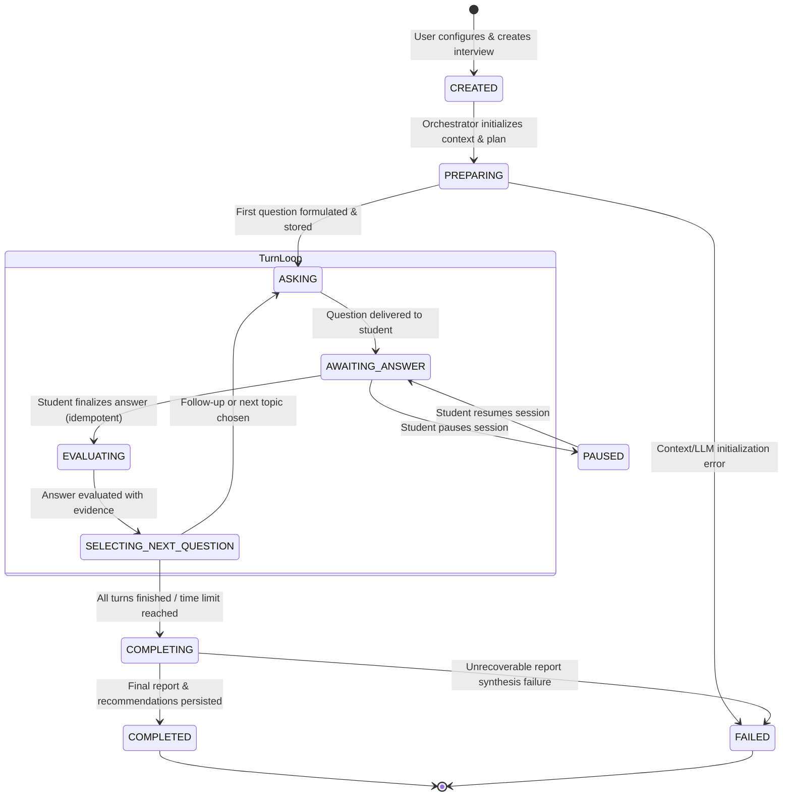

# Chaos Computer Club — Medi-Caps Chapter
# AI Interview Practice: Architecture & Technical Design Document
**Document Version:** 1.0.0  
**Status:** Approved for Implementation  

---

## 1. System Overview & Data Flow

```
+-----------------------------------------------------------------------------------------+
|                                    STUDENT BROWSER                                      |
|                                                                                         |
|  +-------------------------+   +----------------------------+   +--------------------+  |
|  |   Interview Dashboard   |   |     Interview Workspace    |   |  Coaching Report   |  |
|  |   (Redux Toolkit Store) |   |  (Monaco + Speech + Chat)  |   | (Analytics/Rubric) |  |
|  +------------+------------+   +--------------+-------------+   +---------+----------+  |
+---------------|-------------------------------|---------------------------|-------------+
                |                               |                           |
                | REST (HTTPS / JSON)           | SSE (/stream)             | REST
                v                               v                           v
+-----------------------------------------------------------------------------------------+
|                                    FASTAPI BACKEND                                      |
|                                                                                         |
|  +-----------------------------------------------------------------------------------+  |
|  | app.routers.interview (AuthGuard -> extract_access_token -> get_current_member)   |  |
|  +-----------------------------------------------------------------------------------+  |
|                                           |                                             |
|                                           v                                             |
|  +-----------------------------------------------------------------------------------+  |
|  | app.services.interview.orchestrator_service (InterviewOrchestrator)               |  |
|  | - State Machine Validator & Transition Guard                                      |  |
|  | - Idempotency Lock & Deduplication                                                |  |
|  +-----+---------------------+----------------------+---------------------+----------+  |
|        |                     |                      |                     |             |
|        v                     v                      v                     v             |
|  +-----------+        +-------------+        +--------------+      +--------------+     |
|  | Candidate |        | Interview   |        |  Evaluation  |      | LLM Provider |     |
|  | Context   |        | Question    |        |  Engine      |      | Abstraction  |     |
|  | Builder   |        | Planner     |        |  (Rubrics)   |      | Layer        |     |
|  +-----+-----+        +------+------+        +------+-------+      +-------+------+     |
+--------|---------------------|----------------------|----------------------|------------+
         |                     |                      |                      |
         v                     v                      v                      v
+------------------------------------+  +--------------------+  +-------------------------+
|       POSTGRESQL 16 (DURABLE)      |  |  REDIS 7 (TRANS)   |  |     LLM PROVIDERS       |
| - interview_sessions               |  | - idemp locks      |  | - Gemini 2.5 Flash / Pro|
| - interview_questions              |  | - pub/sub relay    |  | - OpenAI / OpenRouter   |
| - interview_answers                |  | - session cache    |  | - Deterministic Mock    |
| - interview_evaluations            |  +--------------------+  +-------------------------+
| - interview_reports                |
| - candidate_profiles               |
+------------------------------------+
```

---

## 2. Relational Database Schema (PostgreSQL 16)

### 2.1 Table: `interview_sessions`
| Column | Type | Constraints | Description |
| :--- | :--- | :--- | :--- |
| `id` | `VARCHAR(36)` | `PRIMARY KEY` | UUIDv4 identifier. |
| `member_id` | `VARCHAR(36)` | `NOT NULL, REFERENCES member_profiles(id) ON DELETE CASCADE` | Session owner. |
| `target_role` | `VARCHAR(100)` | `NOT NULL` | Configured target role (e.g. "Backend Engineer"). |
| `experience_level` | `VARCHAR(20)` | `NOT NULL` | ENTRY_LEVEL, MID_LEVEL, SENIOR. |
| `category` | `VARCHAR(40)` | `NOT NULL` | TECHNICAL, CODING, DSA, SYSTEM_DESIGN, etc. |
| `difficulty` | `VARCHAR(20)` | `NOT NULL` | EASY, MEDIUM, HARD. |
| `duration_minutes` | `INTEGER` | `NOT NULL, DEFAULT 30` | Target interview duration. |
| `preferred_language`| `VARCHAR(30)` | `NOT NULL, DEFAULT 'python'` | Language for coding tracks. |
| `focus_topics` | `JSONB` | `NOT NULL, DEFAULT '[]'` | Selected topic tags. |
| `job_description` | `TEXT` | `NULLABLE` | Target job description snippet. |
| `resume_notes` | `TEXT` | `NULLABLE` | Student background notes. |
| `state` | `VARCHAR(30)` | `NOT NULL, DEFAULT 'CREATED'` | Finite state machine enum. |
| `current_question_index` | `INTEGER` | `NOT NULL, DEFAULT 0` | Active question sequence number. |
| `total_questions_planned` | `INTEGER` | `NOT NULL, DEFAULT 4` | Target question count. |
| `plan_metadata` | `JSONB` | `NOT NULL, DEFAULT '{}'` | Structured interview agenda and roadmap. |
| `started_at` | `TIMESTAMPTZ` | `NULLABLE` | Session initiation timestamp. |
| `paused_at` | `TIMESTAMPTZ` | `NULLABLE` | Timestamp when session was paused. |
| `completed_at` | `TIMESTAMPTZ` | `NULLABLE` | Session completion timestamp. |
| `created_at` | `TIMESTAMPTZ` | `NOT NULL, DEFAULT NOW()` | Creation timestamp. |
| `updated_at` | `TIMESTAMPTZ` | `NOT NULL, DEFAULT NOW()` | Last update timestamp. |

### 2.2 Table: `interview_questions`
| Column | Type | Constraints | Description |
| :--- | :--- | :--- | :--- |
| `id` | `VARCHAR(36)` | `PRIMARY KEY` | UUIDv4 identifier. |
| `session_id` | `VARCHAR(36)` | `NOT NULL, REFERENCES interview_sessions(id) ON DELETE CASCADE` | Parent session. |
| `order_index` | `INTEGER` | `NOT NULL` | 0-based question sequence. |
| `parent_question_id` | `VARCHAR(36)` | `NULLABLE, REFERENCES interview_questions(id)` | References parent if follow-up. |
| `question_type` | `VARCHAR(30)` | `NOT NULL` | PRIMARY, FOLLOW_UP, CODING_CHALLENGE, SYSTEM_DESIGN. |
| `topic` | `VARCHAR(80)` | `NOT NULL` | Algorithmic / architectural topic. |
| `title` | `VARCHAR(200)` | `NOT NULL` | Concise question summary. |
| `prompt` | `TEXT` | `NOT NULL` | Complete interviewer prompt text. |
| `code_starter` | `TEXT` | `NULLABLE` | Starter template for coding questions. |
| `judge_problem_slug` | `VARCHAR(100)` | `NULLABLE` | Linked CCC problem slug if applicable. |
| `expected_criteria` | `JSONB` | `NOT NULL, DEFAULT '[]'` | Rubric criteria keywords. |
| `created_at` | `TIMESTAMPTZ` | `NOT NULL, DEFAULT NOW()` | Generation timestamp. |

### 2.3 Table: `interview_answers`
| Column | Type | Constraints | Description |
| :--- | :--- | :--- | :--- |
| `id` | `VARCHAR(36)` | `PRIMARY KEY` | UUIDv4 identifier. |
| `session_id` | `VARCHAR(36)` | `NOT NULL, REFERENCES interview_sessions(id) ON DELETE CASCADE` | Parent session. |
| `question_id` | `VARCHAR(36)` | `NOT NULL, REFERENCES interview_questions(id) ON DELETE CASCADE` | Question answered. |
| `idempotency_key` | `VARCHAR(64)` | `NOT NULL, UNIQUE` | Deduplication key preventing double submits. |
| `answer_text` | `TEXT` | `NOT NULL` | Candidate response text or transcript. |
| `submitted_code` | `TEXT` | `NULLABLE` | Source code submitted (for coding track). |
| `judge_result` | `JSONB` | `NULLABLE` | Actual execution verdict from judge engine. |
| `audio_duration_seconds` | `FLOAT` | `NULLABLE` | Audio length if recorded in voice mode. |
| `created_at` | `TIMESTAMPTZ` | `NOT NULL, DEFAULT NOW()` | Submission timestamp. |

### 2.4 Table: `interview_evaluations`
| Column | Type | Constraints | Description |
| :--- | :--- | :--- | :--- |
| `id` | `VARCHAR(36)` | `PRIMARY KEY` | UUIDv4 identifier. |
| `session_id` | `VARCHAR(36)` | `NOT NULL, REFERENCES interview_sessions(id) ON DELETE CASCADE` | Parent session. |
| `question_id` | `VARCHAR(36)` | `NOT NULL, REFERENCES interview_questions(id) ON DELETE CASCADE` | Evaluated question. |
| `answer_id` | `VARCHAR(36)` | `NOT NULL, REFERENCES interview_answers(id) ON DELETE CASCADE` | Evaluated answer. |
| `score` | `INTEGER` | `NOT NULL` | 0 - 100 question score. |
| `rubric_scores` | `JSONB` | `NOT NULL` | Dimensional scores (correctness, depth, communication). |
| `strengths` | `JSONB` | `NOT NULL, DEFAULT '[]'` | Specific positive elements observed. |
| `gaps` | `JSONB` | `NOT NULL, DEFAULT '[]'` | Specific technical deficiencies identified. |
| `evidence_quotes` | `JSONB` | `NOT NULL, DEFAULT '[]'` | Verbatim quotes from student answer. |
| `model_answer` | `TEXT` | `NOT NULL` | Stronger / ideal response explanation. |
| `follow_up_recommended` | `BOOLEAN` | `NOT NULL, DEFAULT FALSE` | Whether deeper probing was warranted. |
| `created_at` | `TIMESTAMPTZ` | `NOT NULL, DEFAULT NOW()` | Evaluation timestamp. |

### 2.5 Table: `interview_reports`
| Column | Type | Constraints | Description |
| :--- | :--- | :--- | :--- |
| `id` | `VARCHAR(36)` | `PRIMARY KEY` | UUIDv4 identifier. |
| `session_id` | `VARCHAR(36)` | `NOT NULL, UNIQUE, REFERENCES interview_sessions(id) ON DELETE CASCADE` | 1-to-1 with session. |
| `member_id` | `VARCHAR(36)` | `NOT NULL, REFERENCES member_profiles(id) ON DELETE CASCADE` | Student evaluated. |
| `overall_score` | `INTEGER` | `NOT NULL` | 0 - 100 composite interview rating. |
| `verdict` | `VARCHAR(40)` | `NOT NULL` | STRONG_HIRE, HIRE, LEANING_HIRE, LEANING_NO_HIRE, NO_HIRE. |
| `executive_summary` | `TEXT` | `NOT NULL` | Comprehensive coaching overview. |
| `dimension_breakdown` | `JSONB` | `NOT NULL` | Scores across correctness, problem-solving, depth, etc. |
| `top_strengths` | `JSONB` | `NOT NULL, DEFAULT '[]'` | Standout technical proficiencies. |
| `areas_to_improve` | `JSONB` | `NOT NULL, DEFAULT '[]'` | Prioritized developmental areas. |
| `recommended_practice`| `JSONB` | `NOT NULL, DEFAULT '[]'` | Concrete practice problems and study modules. |
| `created_at` | `TIMESTAMPTZ` | `NOT NULL, DEFAULT NOW()` | Report generation timestamp. |

---

## 3. Finite State Machine Specification



### Invariants:
1. **Ownership Enforcement:** All endpoints query `session.member_id == current_member.id`. Unauthorized requests receive `403 FORBIDDEN` or `404 NOT FOUND`.
2. **Idempotent Transitions:** If an answer submission arrives with an existing `idempotency_key`, the backend returns the stored answer immediately without triggering redundant LLM calls.
3. **No Phantom Transitions:** A session in `COMPLETED` rejects any new answer submissions with `400 BAD REQUEST`.

---

## 4. LLM Provider Architecture

```python
class LLMProvider(ABC):
    @abstractmethod
    async def generate_structured(
        self,
        system_prompt: str,
        user_prompt: str,
        response_model: Type[T],
        temperature: float = 0.2,
        timeout_seconds: float = 25.0,
    ) -> T:
        """Generates Pydantic-validated JSON output from the model."""
        pass

    @abstractmethod
    async def generate_text(
        self,
        system_prompt: str,
        user_prompt: str,
        temperature: float = 0.5,
        timeout_seconds: float = 30.0,
    ) -> str:
        """Generates raw text response."""
        pass
```

### Supported Providers:
1. `DeterministicMockLLMProvider`: Deterministic, offline provider utilizing pre-calibrated algorithmic responses matching question schemas. Zero network latency, zero API key requirement; used for test suites and offline local environments.
2. `GeminiProvider`: Google Gemini 2.5 Flash / Pro API with JSON schema enforcement.
3. `OpenAICompatibleProvider`: Compatible with OpenAI (`gpt-4o-mini`, `gpt-4o`), OpenRouter, DeepSeek, or locally hosted Ollama instances.
