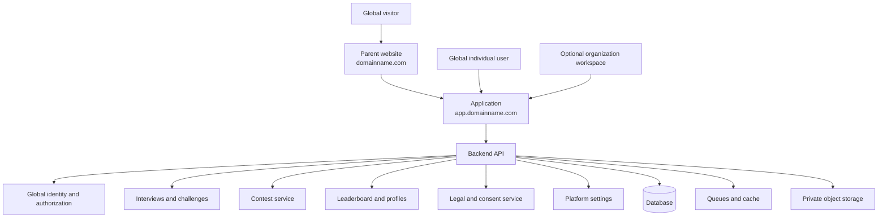

# GLOBAL PLATFORM TARGET ARCHITECTURE

## Identity
Platform user identity is independent of organization. Membership is many-to-many and optional. A user may have zero, one, or many organization memberships.

## Resource visibility
- `public`: globally available to eligible users.
- `unlisted`: not listed publicly; access follows explicit sharing rules.
- `organization_private`: authorized members of the referenced organization only.
- `platform_admin_only`: internal administration.

All resource scope checks occur server-side on every relevant read/write path.

## Host strategy
Apex domain is the marketing website; app subdomain is product UI; API/admin/docs/status subdomains are optional. Separate hostnames do not require separate microservices or deployments.

## Global settings
Brand, URLs, auth/signup policy, email, legal versions, feature flags, contest defaults, upload policy, locale/timezone, maintenance mode. Secrets stay in secret manager/environment, not ordinary settings records.
