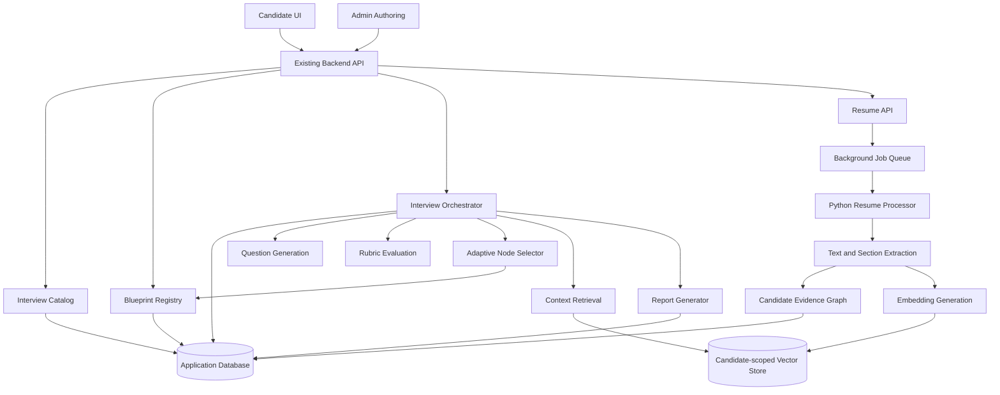
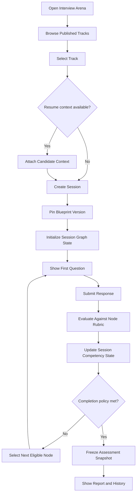
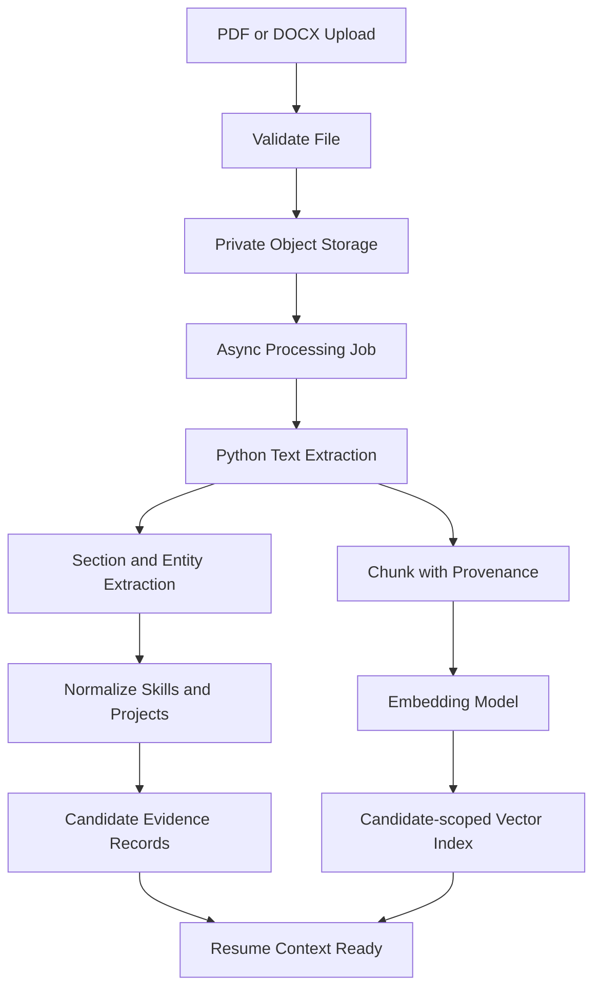
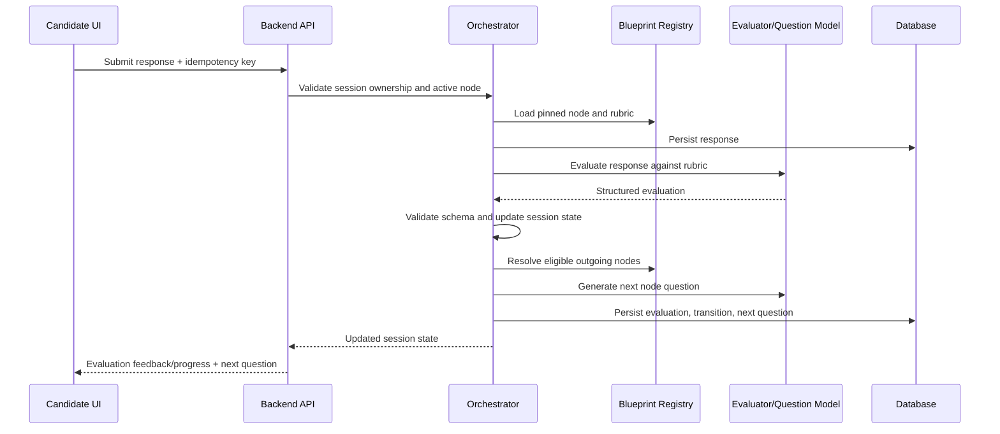
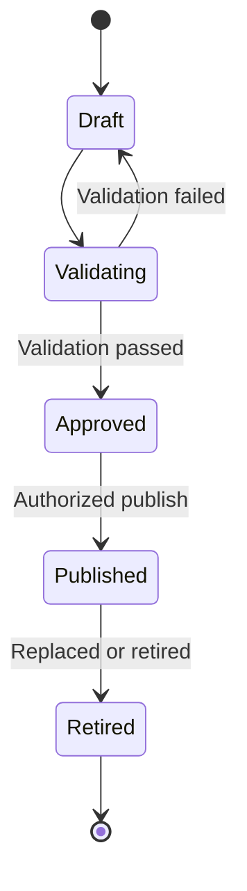

# Architecture and Flow Diagrams

## System architecture

## Candidate flow

## Optional resume processing

## Response evaluation sequence

## Blueprint lifecycle

## Important boundaries

- The blueprint graph is authored and versioned; the candidate session only maintains a runtime overlay.
- Resume context is optional and candidate-scoped.
- The candidate cannot alter graph topology or node instructions.
- The graph selector must only return nodes belonging to the pinned blueprint version.
- A deterministic fallback path must exist if model services fail.
